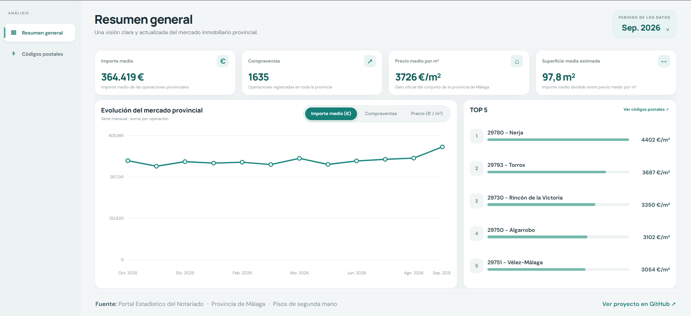

# ScraperPEN

**ScraperPEN** es un proyecto de extracción, almacenamiento, procesamiento y visualización de estadísticas inmobiliarias de la provincia de Málaga. Utiliza Python y Playwright para consultar el Portal Estadístico del Notariado, SQLite para conservar el histórico y un dashboard web para explorar los resultados.

El repositorio reúne tanto el proceso de extracción como la aplicación web que presenta los datos.



## Dashboard

El dashboard permite consultar la evolución de los indicadores provinciales y explorar los resultados disponibles por código postal. Incluye gráficos temporales, un ranking de códigos postales y un mapa interactivo.

- **Aplicación publicada:** añade aquí la URL de GitHub Pages cuando esté disponible.
- **Fuente de los datos:** Portal Estadístico del Notariado.
- **Ámbito:** provincia de Málaga y códigos postales incluidos en el catálogo del proyecto.
- **Tipo de vivienda analizado:** pisos de segunda mano.

## Qué hace el proyecto

1. Consulta ubicaciones del catálogo mediante un navegador automatizado con Playwright.
2. Descarga los informes disponibles y extrae las métricas estadísticas.
3. Guarda las observaciones y el historial de consultas en SQLite.
4. Transforma los datos a una tabla resumida para facilitar su análisis.
5. Exporta la tabla resumida a un archivo JSON.
6. Carga ese JSON en un dashboard estático desarrollado con HTML, CSS y JavaScript.

## Indicadores del dashboard

- **Precio medio por metro cuadrado:** precio medio publicado para el periodo y ámbito seleccionados.
- **Compraventas:** número de operaciones registradas.
- **Importe medio:** importe medio de las operaciones.
- **Superficie media estimada:** cociente entre el importe medio y el precio medio por metro cuadrado. Es un cálculo derivado y debe interpretarse como una estimación, no como una medición directa de la superficie de cada vivienda.

La vista general muestra la evolución provincial y un ranking de códigos postales. La vista de códigos postales permite consultar los periodos disponibles y visualizar los valores sobre el mapa.

## Tecnologías

| Tecnología            | Uso                                  |
| ---------------------- | ------------------------------------ |
| Python                 | Automatización y procesamiento      |
| Playwright             | Navegación automatizada y descargas |
| pandas                 | Transformación de datos             |
| openpyxl               | Lectura y escritura de Excel         |
| python-dotenv          | Carga de configuración local        |
| SQLite                 | Base de datos del proyecto           |
| HTML, CSS y JavaScript | Dashboard web                        |
| Leaflet                | Mapa interactivo                     |
| GeoJSON                | Geometrías de códigos postales     |

## Estructura del repositorio

```text
ScraperPEN/
├── data/                       # Datos locales de trabajo (no versionados)
│   ├── database/
│   ├── raw/
│   │   ├── excel/
│   │   └── pdf/
│   └── processed/
├── docs/                       # Documentación del proyecto
│   ├── architecture.md
│   ├── database.md
│   ├── data_dictionary.md
│   ├── decisions.md
│   ├── operations.md
│   └── images/
├── resources/                  # Recursos de referencia usados durante el desarrollo
├── src/
│   ├── ScraperPEN.py
│   ├── CreateDatabase.py
│   ├── DatabaseManager.py
│   ├── ProcessData.py
│   └── ExportWebData.py
├── web/
│   ├── index.html
│   ├── assets/
│   │   ├── css/styles.css
│   │   └── js/app.js
│   └── data/
│       ├── datos_resumen.json
│       └── malaga.geojson
├── .env.example
├── .gitignore
├── requirements.txt
└── README.md
```

## Datos incluidos en la versión actual

La exportación incluida en `web/data/datos_resumen.json` corresponde a la última generación disponible en el repositorio. Como referencia, la copia revisada el **27 de noviembre de 2026** contiene:

| Elemento                                  |                           Resultado |
| ----------------------------------------- | ----------------------------------: |
| Ubicaciones del catálogo SQLite          |                                 161 |
| Códigos postales del catálogo           |                                 160 |
| Ámbito provincial                        |                                   1 |
| Filas de `datos_crudos`                 |                               2.742 |
| Filas de `datos_resumen`                |                                 914 |
| Intentos registrados en `log_descargas` |                                 232 |
| Ubicaciones con datos en el JSON          |                                  63 |
| Periodo estadístico incluido             | Junio de 2025 – septiembre de 2026 |

El JSON contiene observaciones de **62 códigos postales** y una ubicación provincial. El catálogo incluye más códigos postales que los que tienen observaciones disponibles en la exportación. Por eso, el selector del dashboard muestra los códigos postales que tienen datos en el JSON; los códigos sin observaciones no aparecen como opciones de consulta.

Estas cifras describen una copia concreta de la base de datos y pueden cambiar al actualizar el histórico y volver a generar la exportación.

## Cómo ver el dashboard en local

No es necesario ejecutar el scraper para abrir el dashboard si ya están presentes los archivos JSON y GeoJSON.

Desde la raíz del proyecto:

```powershell
python -m http.server 8000 --directory web
```

Abre en el navegador:

```text
http://localhost:8000
```

Se utiliza un servidor HTTP local porque el navegador debe cargar el JSON y el GeoJSON mediante `fetch`; abrir `index.html` directamente como archivo puede impedir esas peticiones.

## Cómo preparar el scraper

### 1. Crear el entorno e instalar dependencias

En PowerShell, desde la raíz del repositorio:

```powershell
python -m venv .venv
.\.venv\Scripts\Activate.ps1
python -m pip install -r requirements.txt
python -m playwright install chromium
```

### 2. Configurar las cuentas

Copia `.env.example` como `.env` y completa las variables de las cuentas que tengas configuradas para el portal. El scraper utiliza cuatro identificadores internos de cuenta (`cuenta_1` a `cuenta_4`):

```dotenv
PEN_USER_1_EMAIL=
PEN_USER_1_PASSWORD=
PEN_USER_2_EMAIL=
PEN_USER_2_PASSWORD=
PEN_USER_3_EMAIL=
PEN_USER_3_PASSWORD=
PEN_USER_4_EMAIL=
PEN_USER_4_PASSWORD=
PEN_CP_PRUEBA=29710
PEN_EJECUTAR_TODOS_CP=0
```

El archivo `.env` contiene configuración local y no forma parte del repositorio.

### 3. Ejecutar una ubicación concreta

```powershell
python -m src.ScraperPEN 29001
```

También se pueden indicar varias claves de ubicación:

```powershell
python -m src.ScraperPEN 29001 29002
```

Los argumentos se resuelven mediante el campo `clave_portal` del catálogo SQLite.

### 4. Ejecutar el modo general

Para habilitar el modo general en la sesión actual de PowerShell:

```powershell
$env:PEN_EJECUTAR_TODOS_CP = "1"
python -m src.ScraperPEN
```

Al terminar, se puede devolver el modo de prueba:

```powershell
$env:PEN_EJECUTAR_TODOS_CP = "0"
```

El modo general prioriza ubicaciones cuyo último intento terminó con error y después ubicaciones que todavía no se han consultado. No vuelve a incluir automáticamente ubicaciones cuyo último estado sea `completada` o `sin_datos_cp`.

## Actualizar los datos del dashboard

El flujo de actualización es:

```powershell
python -m src.ProcessData
python -m src.ExportWebData
```

- `ProcessData.py` transforma `datos_crudos` en `datos_resumen`.
- `ExportWebData.py` genera `web/data/datos_resumen.json`.

El JSON contiene los datos que consume directamente la aplicación web. Para que el dashboard muestre una actualización, el JSON generado debe estar disponible en `web/data/` junto con `malaga.geojson`.

## Documentación

- [Arquitectura](docs/architecture.md): cómo se conectan los componentes.
- [Base de datos](docs/database.md): tablas, claves y relaciones de SQLite.
- [Diccionario de datos](docs/data_dictionary.md): significado de campos e indicadores.
- [Decisiones técnicas](docs/decisions.md): criterios de diseño del proyecto.
- [Guía de operaciones](docs/operations.md): instalación, ejecución y actualización.

## Licencia

Este proyecto está publicado bajo la licencia [MIT](LICENSE).

Copyright (c) 2026 MariaOrtunoR.
